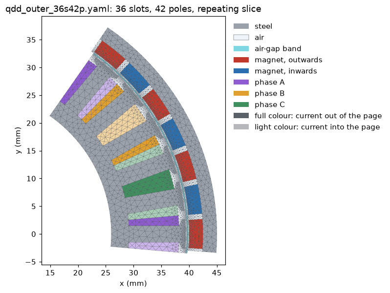
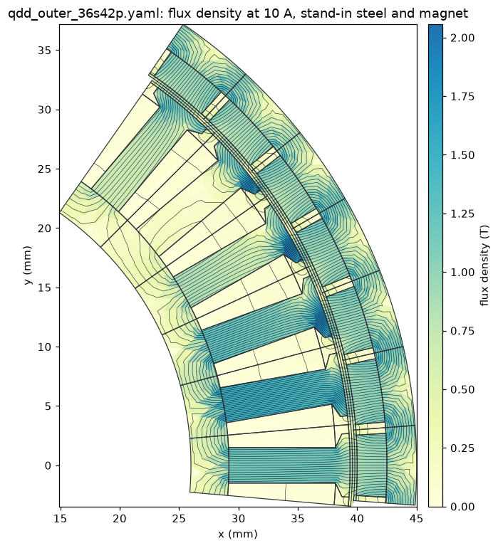

# Pole-Craft

[](https://pypi.org/project/polecraft/)

Open-source design and simulation tool for quasi-direct-drive (QDD) motors.

> **Status: early development (version 0.0.1).** What 0.0.1 can do: load a motor design file and check it, work out the winding layout and the slice of the motor that repeats, build the cross-section of an outer-rotor surface-magnet motor as labelled regions (steel, coils, magnets, air), mesh it with triangles and save a picture, from the `polecraft mesh` command or from Python. What it cannot do: **it does not simulate anything yet.** There is no field solver, so it reports no torque, back-EMF or losses, and inner-rotor motors are not supported. The roadmap below shows what comes next.



## What it will do

Pole-Craft takes a motor described in a simple design file and tells you how it performs:

- Builds the motor geometry from parameters (slots, poles, diameters, magnet shape)
- Runs 2D electromagnetic finite-element analysis
- Reports torque, cogging, back-EMF, torque constant, losses and efficiency
- Lets you change magnet grade, steel grade, wire size and turns, and compare the results
- Sweeps many design variants to find the best one for a target

The first focus is surface-magnet outer-rotor and inner-rotor motors of the kind used in QDD robot actuators.

## Why

Commercial motor design tools are expensive, and their free student versions cannot be used for commercial work. Existing open-source tools are general-purpose. Pole-Craft aims to make exploring QDD motor designs fast, scriptable and free for anyone to use.

## Install

Needs Python 3.11 or newer.

```
pip install "polecraft[mesh]"
```

A plain `pip install polecraft` has no mesher, because the mesher is [Gmsh](https://gmsh.info), which is GPL-licensed and so is kept as an optional extra that Pole-Craft calls but does not include. Without it, design files can still be loaded and checked and their geometry built from Python, and any command that needs a mesh stops with one line giving the install command above.

From version 0.0.2, which has the field solver and is not released yet, a faster solver is optional. To install it as well:

```
pip install "polecraft[mesh,pardiso]"
```

This adds [pypardiso](https://github.com/haasad/PyPardiso) and with it PARDISO from Intel's MKL, which makes a field solve quicker than the solver that is always there (SciPy's SuperLU): by about a tenth on a small model such as the slice of an example motor, and by a quarter or more on larger ones. MKL is free to use but not open source, which is why it is not installed by default. It exists for Intel and AMD processors on Windows and Linux only: on a Mac, or on an ARM processor, the command above installs everything else and leaves the faster solver out. Installing it does not switch it on: SuperLU stays the default, and PARDISO is used when you ask for it by name, `solve(problem, solver="pardiso")`. The first solve of a run takes about a third of a second longer while MKL loads, so the gain shows over many solves or on large models. Without it nothing is lost but speed: the timing report of a solve gives the command above. If you ask for `pardiso` by name where it is not installed, a warning says so and the work goes on with SuperLU. To add it to an existing install: `pip install "polecraft[pardiso]"`.

On Linux, Gmsh needs a few system libraries that servers, containers and WSL often lack. If `polecraft mesh` reports `libGLU.so.1: cannot open shared object file` (or a similar library name), install them. On Debian or Ubuntu:

```
sudo apt-get install libglu1-mesa libxcursor1 libxft2 libxinerama1 libxrender1 libgomp1
```

## Try it

Save an example design, for instance [qdd_outer_36s42p.yaml](https://raw.githubusercontent.com/pole-craft/pole-craft/main/designs/qdd_outer_36s42p.yaml), into the folder you are working in. The others are in the [designs folder](https://github.com/pole-craft/pole-craft/tree/main/designs), and a clone of the repository contains them all. Then mesh it and save a picture:

```
polecraft mesh qdd_outer_36s42p.yaml
```

This writes `qdd_outer_36s42p_mesh.png` in the current folder and prints the mesh size and how long each stage took. Only the slice of the motor that repeats is meshed; add `--full` for the whole machine, `-o` to choose the output file (`.png`, `.svg` or `.pdf`), and `--size 0.5` for a finer mesh.

From version 0.0.2, which is not released yet (until then, install from a clone of the repository as described under "Development setup"), the field can be solved and drawn as well:

```
polecraft solve qdd_outer_36s42p.yaml --current 10
```

This solves the magnetic field at one rotor position with 10 A peak in the phases, prints the torque, the flux linked by each phase and how the solve converged, and writes `qdd_outer_36s42p_field.png`: flux density as colour, with field lines and the outline of every part over it. The options of `polecraft mesh` work here too (a mesh much coarser than `--size 5` is refused as too coarse to solve), and `--advance` shifts the current, in electrical degrees.



Real material data is not in the package yet. `polecraft solve` uses a stand-in steel curve made from a formula and a stand-in magnet (1.2 T unless `--remanence` says otherwise), and says so in what it prints, so its numbers show how the tool behaves, not how a motor performs. It solves a 2D model with no end effects, at rotor angle 0 only.

The design files are plain YAML, with lengths in millimetres. The dimensions in the examples are placeholders typical of each motor size, not measured or optimised designs. The design-file format may change between 0.0.x versions.

## Use from Python

The same steps can be run from a script:

```python
from polecraft import load_design, machine_for
from polecraft.core.mesh import build_mesh
from polecraft.plot import plot_mesh

design = load_design("qdd_outer_36s42p.yaml")
machine = machine_for(design)
print(machine.symmetry())                # the slice that repeats

geometry = machine.build_geometry()      # full=True for the whole machine
mesh = build_mesh(geometry, size=1.0)    # needs Gmsh; smaller size, finer mesh
print(len(mesh.nodes), len(mesh.triangles))

plot_mesh(mesh, geometry, "motor.png")
```

A longer example that also prints the winding layout is in [examples/mesh_a_design.py](https://github.com/pole-craft/pole-craft/blob/main/examples/mesh_a_design.py). The Python interface may change between 0.0.x versions.

## Examples

Scripts in the [examples folder](https://github.com/pole-craft/pole-craft/tree/main/examples) of the repository, each run with `python examples/<name>`. The first two run with the released 0.0.1. The rest use the field solver, which is in the repository and comes with version 0.0.2.

| Example | What it shows | Needs Gmsh |
|---|---|---|
| [mesh_a_design.py](https://github.com/pole-craft/pole-craft/blob/main/examples/mesh_a_design.py) | Load a design, print its winding, mesh it, save a picture | yes |
| [winding_layouts.py](https://github.com/pole-craft/pole-craft/blob/main/examples/winding_layouts.py) | Layout, repeating slice and winding factor for several slot and pole counts | no |
| [material_models.py](https://github.com/pole-craft/pole-craft/blob/main/examples/material_models.py) | Air, a magnet and saturating steel as the solver sees them; the placeholder steel beside its formula | no |
| [solve_a_motor.py](https://github.com/pole-craft/pole-craft/blob/main/examples/solve_a_motor.py) | Solve the field of a motor; torque, flux linkage, convergence and timing reports | yes |
| [torque_against_current.py](https://github.com/pole-craft/pole-craft/blob/main/examples/torque_against_current.py) | Torque at several currents, showing the steel saturate | yes |
| [slice_against_whole_machine.py](https://github.com/pole-craft/pole-craft/blob/main/examples/slice_against_whole_machine.py) | The repeating slice gives the whole machine's torque and flux linkage for a fraction of the work | yes |
| [picture_of_the_field.py](https://github.com/pole-craft/pole-craft/blob/main/examples/picture_of_the_field.py) | Save a picture of flux density, field lines and region outlines | yes |
| [choose_a_solver.py](https://github.com/pole-craft/pole-craft/blob/main/examples/choose_a_solver.py) | List the sparse solvers on your machine and time each | yes |
| [core_with_an_air_gap.py](https://github.com/pole-craft/pole-craft/blob/main/examples/core_with_an_air_gap.py) | A hand-built saturating core, checked against the magnetic circuit formula | no |
| [inductance_of_a_coil.py](https://github.com/pole-craft/pole-craft/blob/main/examples/inductance_of_a_coil.py) | Inductance of a hand-built coil from its flux linkage, checked against a formula | no |

The motor examples use a placeholder steel curve and a stand-in magnet, not the grades the design names, so their numbers show how the tool behaves, not how the motor performs.

## How the solver is checked

The field solver, which is not in a release yet, is checked in two ways. Each part is first tested on a case with a known answer (the field round a wire, a magnetic circuit with an air gap, the inductance of a coil). The whole is then compared with [FEMM](https://www.femm.info), an independent 2D field program, on the 36-slot, 42-pole example motor. Pole-Craft writes the FEMM model from the same regions, steel table, magnet and currents that its own solver is given (`polecraft.femm`), and FEMM's results are stored in [tests/data/femm](https://github.com/pole-craft/pole-craft/tree/main/tests/data/femm) with the script that makes them, so the comparison runs with the tests and needs no FEMM.

Results at one rotor position, Pole-Craft on its default mesh of the repeating slice against FEMM on a fine mesh of the whole machine:

| Quantity | Pole-Craft | FEMM | Difference |
|---|---|---|---|
| Torque at 10 A | 3.187 N m | 3.191 N m | 0.1 % |
| Torque at 40 A (steel saturating) | 9.527 N m | 9.506 N m | 0.2 % |
| Torque with no current | 0.000 N m | 0.000 N m | none, as the symmetry of that position requires |
| Flux linked by phase A, no current | 10.014 mWb | 10.005 mWb | 0.1 % |
| Largest phase flux linkage at 40 A | 16.553 mWb | 16.603 mWb | 0.3 % |
| Main wave of the air-gap flux density, no current | 1.029 T | 1.028 T | 0.1 % |
| Main wave of the air-gap flux density, 40 A | 0.980 T | 0.978 T | 0.2 % |

Over all three currents the two agree within 0.3 % on torque, on the flux linked by each phase within 0.7 % of the largest phase's, and within 0.3 % on the main wave of the flux density in the air gap. A phase whose linkage is near zero at that position differs by up to 3 % of its own small value. Making Pole-Craft's mesh twice as fine changes its torque by under 0.2 %, and FEMM's own answer moves by 0.1 % between its normal and its fine mesh.

Time for the same job (mesh the motor and solve the three currents), measured once on one laptop:

| Run | Nodes | Time |
|---|---|---|
| Pole-Craft, repeating slice, default mesh | 2,480 | 0.5 s |
| Pole-Craft, whole machine, mesh four times finer | 159,043 | 43 s |
| FEMM, whole machine, normal mesh | 70,246 | 112 s |
| FEMM, whole machine, fine mesh | 229,310 | 943 s |

Most of the gain comes from solving only the slice that repeats, on a mesh no finer than the answer needs; on the whole machine with a mesh of similar size Pole-Craft is still several times quicker. FEMM's times include starting the program and drawing the model.

This is a check of the 2D solver only. Both programs use the same placeholder steel curve and stand-in magnet and solve the same 2D model, so it says nothing yet about how close either is to a real motor: end effects, which matter in short, wide motors, and real material data come later. FEMM does far more than this comparison uses, and it remains the reference Pole-Craft is checked against.

## Roadmap

- [x] Parametric geometry and meshing for QDD motors (outer rotor; inner rotor to follow)
- [ ] 2D field solver with saturated steel and permanent magnets
- [ ] Rotation: cogging torque, back-EMF, torque ripple
- [ ] Material and winding library
- [ ] Losses, torque-speed curve and efficiency map
- [ ] Parallel and GPU-accelerated design sweeps
- [ ] Validation against FEMM and measured motors
- [ ] Gear module for actuator-level results
- [ ] 3D verification

Changes in each release are listed in the [changelog](https://github.com/pole-craft/pole-craft/blob/main/CHANGELOG.md).

## Built with

Python, [Gmsh](https://gmsh.info) for meshing, and [FEMM](https://www.femm.info) as an independent reference for validation.

## Development setup and running the tests

Clone the repository, then install it in a virtual environment together with the test tools:

```
git clone https://github.com/pole-craft/pole-craft.git
cd pole-craft
python -m venv .venv
.venv\Scripts\activate          # Linux/macOS: source .venv/bin/activate
pip install -e ".[dev,mesh]"
pytest
```

Without the `mesh` extra everything except meshing works, and the meshing tests are skipped.

## Contributing

The project is just starting. Ideas, questions, bug reports and motor data for validation are welcome: please [open an issue](https://github.com/pole-craft/pole-craft/issues).

How the package fits together, and how to add a machine type, is described in [docs/architecture.md](https://github.com/pole-craft/pole-craft/blob/main/docs/architecture.md).

## License

Apache License 2.0. See [LICENSE](https://github.com/pole-craft/pole-craft/blob/main/LICENSE).
